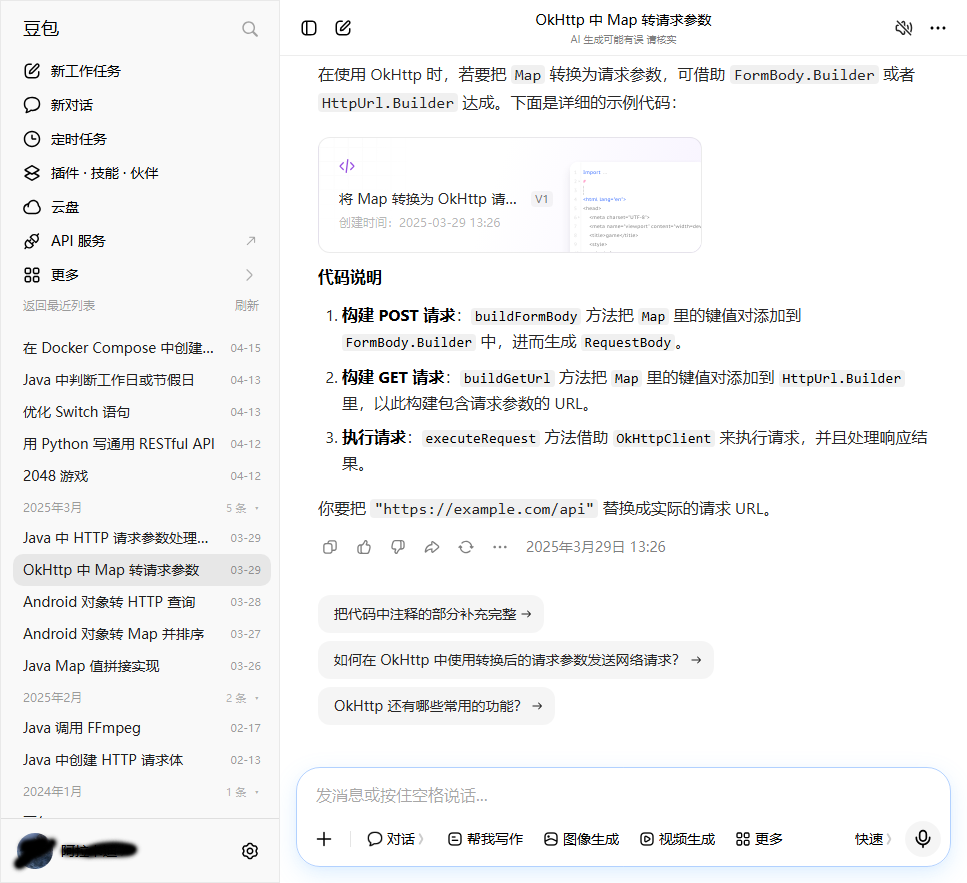

# Doubao Sidebar: Group Conversations by Year & Month

A Tampermonkey userscript for the **Doubao web app** (https://www.doubao.com/chat). It adds a *Group by year & month* switch to the left sidebar; flip it and your **entire conversation history** is regrouped by `YYYY-MM` instead of the native flat "recent" list.

- Install from GreasyFork: https://greasyfork.org/en/scripts/604029
- Install from GitHub: https://raw.githubusercontent.com/javalittleman1/doubao_history/master/doubao-yearmonth-group.user.js
- GreasyFork direct link: https://update.greasyfork.org/scripts/604029/doubao-yearmonth-group.user.js

> 中文说明见 [README.md](README.md)

---

## Why

The native sidebar only keeps a few dozen recent conversations loaded, so anything older is effectively unreachable, and there is no time-based filter. This script calls the site's own conversation APIs to pull the **full history across devices and projects** (761 conversations in 23 month groups on the tested account), then rebuilds it as a collapsible month list.

## Features

| Feature | Detail |
| --- | --- |
| One-click switch | A small row above the *Projects* section: `Group by year & month` ↔ `Back to recent list` |
| Full history | Pages through the internal list API instead of the sidebar's lazily loaded slice |
| Month groups | Descending groups like `2024年1月`, `2024年2月`…, each showing its count; click a header to collapse / expand |
| Title backfill | The list API omits titles, so a batch API fills them in progressively |
| Active state | The conversation you are viewing is highlighted inside the grouped view |
| Center on select | The selected conversation is scrolled to the **vertical center** of the sidebar, both after a click and after a full page reload |
| No page reload | Clicks go through the site's own client-side router (`history.pushState` + `popstate`), so the page is not reloaded and the sidebar keeps its position |
| State memory | Once enabled, the grouped view survives conversation switches and page reloads |
| Caching | 10-minute list cache; the `刷新` (refresh) button forces a re-read |
| Dark mode | All colors are CSS variables and follow Doubao's dark theme |
| Robustness | Single-instance guard, click debounce, and automatic re-mount after React re-renders |

## Installation

1. Install the **Tampermonkey** extension (Chrome / Edge / Firefox).
2. Click the extension icon → *Create a new script* → clear the template.
3. Paste the whole `doubao-yearmonth-group.user.js` file and save with `Ctrl+S`.
4. Open https://www.doubao.com/chat/ and reload the page once.

You can also drag the `.user.js` file into a browser window; Tampermonkey will show its install page.

## Usage

- A new row marked **按年月分组** appears between *More* and *Projects*. Click it to enter the grouped view; it turns into **返回最近列表** and clicking again restores the native list.
- Click a month header to collapse / expand that month.
- Clicking a conversation opens it; the item is highlighted and centered in the list.
- `Ctrl`-click (`⌘` on macOS) opens the conversation in a new tab, matching native behaviour.
- The **刷新** button bypasses the cache and re-reads everything.

## Configuration

Edit the `CFG` block at the top of the script:

| Key | Default | Meaning |
| --- | --- | --- |
| `pageSize` | `50` | Page size for the list API (50 is the server-side cap) |
| `maxPages` | `60` | Maximum pages fetched (≈3000 conversations); raise it if you have more |
| `nameChunk` | `50` | Conversations per title-backfill batch |
| `nameWorkers` | `4` | Concurrent title requests; lower it on a slow network |
| `cacheMs` | `600000` | List cache lifetime (10 minutes) |
| `groupField` | `'create'` | Group by creation time; set to `'update'` to group by last activity |
| `storageKey` | `'dbym_enabled_v1'` | localStorage key holding the switch state |

## How it works

1. **Fetch the full list** — `POST /im/chain/recent_conv` with `cmd: 3200`, `direction: 2` (page from oldest forward), `filter.device_filter: 0` (all devices, including conversations created by the desktop client). `limit` is clamped to 50 server-side; paging continues via `next_conv_version` until exhausted.
2. **Backfill titles** — the list API does not return conversation titles, so `POST /im/conversation/batch_get` (`cmd: 1111`, `option.recent_message_count_per_conv: 0`) fetches `name` in batches of 50 with 4 parallel workers and fills them in as they arrive.
3. **Render** — the native list root `[data-testid="chat_list_wrapper"]` is hidden and `#dbym-panel` is inserted after it, grouping by `create_time` (second-level Unix timestamp) in descending order.
4. **Navigate** — item clicks are intercepted: `history.pushState` changes the URL and a `popstate` event is dispatched so the site's own router takes over. If the document title has not changed within 3 seconds, it falls back to a normal `location.href` navigation.
5. **Center** — the target conversation id is stashed in `sessionStorage['dbym_center_id']`; after a render or route change the script measures the target against the scroll container and adjusts `scrollTop` so the item lands in the middle (bottom items stop at the scroll limit).

> Both APIs require `Content-Type: application/json; encoding=utf-8` plus `Agw-Js-Conv: str`, otherwise the server replies with an "unsupported encoding type" error.

## FAQ

**Why does the first switch take a few seconds?**
The full list plus title backfill takes roughly 5–15 seconds depending on history size; titles briefly show a loading placeholder.

**"读取失败" (read failed)?**
Usually an expired session or an API change. Make sure the web app works, then hit **刷新**. If it still fails, the API shape has changed and `LIST_API` / `BATCH_API` need updating.

**Does it work in the Doubao desktop app?**
No. The desktop client is a standalone application and cannot run browser extensions.

**Why do I see conversations created on the desktop client?**
`device_filter: 0` requests all devices, which yields a more complete list.

**What if I have a huge history?**
The default cap is 60 pages (~3000 conversations). Lowering `maxPages` is faster but cuts off older months.

## Compatibility

- Chrome / Edge / Firefox with Tampermonkey (`@grant none`, no GM APIs used).
- Matches `https://www.doubao.com/*`, `@noframes`, injected at `document-idle`.
- Web app only. It depends on internal APIs and DOM structure, so site changes may require updates.

## Changelog

- **1.3.3** — Added a script icon (Doubao-style round face inside a gear badge) with `@icon` / `@icon64` metadata.
- **1.3.2** — Added `@homepageURL` / `@supportURL` metadata pointing at the GitHub repository.
- **1.3.1** — Source of truth moved to GitHub; GreasyFork now tracks it through source sync. File renamed to `doubao-yearmonth-group.user.js`.
- **1.3.0** — Item clicks now use the client-side router (no page reload); added active highlighting and center-on-select scrolling.
- **1.2.0** — Fixed the switch row scrolling away and the scroll position being lost when toggling; added click debounce and a single-instance guard.
- **1.1.0** — Switched to all-device full pagination with batched title backfill, fixing "only 50 items" and "every title is untitled".
- **1.0.0** — First working version.

## Releasing a new version

The GitHub repository (`javalittleman1/doubao_history`) is the single source of truth; the GreasyFork listing follows it via source sync.

1. Edit the code and bump `@version` in the script header (an unchanged version is reported as "no update" and never published).
2. `git commit` + `git push` (GitLab is the primary remote; you can also push straight to `https://github.com/javalittleman1/doubao_history.git`).
3. GreasyFork is set to automatic sync and will pick up the new raw file on its next check. To publish immediately, press "Update settings and sync now" on the GreasyFork admin page.

> GreasyFork's webhook endpoint returns 403 to GitHub deliveries, so this repo does not use one. Also note `raw.githubusercontent.com` sits behind a few-minute CDN cache: syncing seconds after a push can still read the old file and report "no update".

Both install channels update independently: GreasyFork installs follow GreasyFork's generated `@updateURL`, GitHub raw installs are checked by Tampermonkey against the raw URL.

## Disclaimer

Unofficial personal enhancement, not affiliated with Doubao. The script calls the site's own internal APIs and only reads your own conversation data inside your own logged-in browser. Use at your own risk; API changes may break it and you will need to maintain it yourself.
